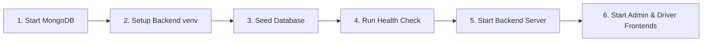

# Abraxas Logistics Platform — Deployment & Operations Guide

**Milestone 11.2 — Deployment Packaging & Environment Configuration**  
*Pune Hybrid QGA + QPSO Last-Mile Logistics Engine*

---

## 1. System Architecture & Prerequisites

The Abraxas platform consists of three core components:
1. **FastAPI Backend (`backend/`)**: Python 3.11+ REST API running the QGA + QPSO optimization pipeline, MongoDB aggregations, and TomTom traffic proxies.
2. **Admin Web Portal (`frontend-admin/`)**: React 19 + Vite single-page application with Leaflet live fleet maps and analytics dashboards.
3. **Driver Web Portal (`frontend-driver/`)**: React 19 + Vite mobile-optimized interface for driver manifests, turn-by-turn simulation, and delivery events.
4. **MongoDB Database**: Document store with native `$jsonSchema` validation and sub-millisecond aggregation pipelines.

### Minimum System Requirements
- **OS:** macOS 13+ (Apple Silicon or Intel), Ubuntu 22.04+ LTS, or Debian 12
- **Python:** 3.11.x or higher
- **Node.js:** v18.x or v20.x+ (with `npm`)
- **MongoDB:** v7.0.x community edition (or MongoDB Atlas URI)
- **Memory:** Minimum 4 GB RAM (8 GB recommended)

---

## 2. Environment Configuration

### A. Backend Configuration
Create `backend/.env` from the example template:
```bash
cp backend/.env.example backend/.env
```

| Variable | Description | Default / Example Value |
|:---|:---|:---|
| `MONGO_URI` | MongoDB connection string | `mongodb://localhost:27017/logistics_db` |
| `TOMTOM_API_KEY` | TomTom Traffic API key (optional) | `your_api_key_here` (falls back to simulated curve) |
| `JWT_SECRET` | Secret key for signing JWT tokens | `abraxas_secret_key_demo_2026` |
| `APP_ENV` | Runtime environment | `development` (or `production`) |
| `CLOCK_ACCELERATION_RATIO` | Live vehicle movement speed multiplier | `60.0` (1 real min = 1 sim hour) |

### B. Frontend Portals Configuration
Create environment files for both frontend portals:
```bash
cp frontend-admin/.env.example frontend-admin/.env
cp frontend-driver/.env.example frontend-driver/.env
```
Ensure `VITE_API_BASE_URL=http://localhost:8000` is set in both.

---

## 3. Step-by-Step Local Setup & Startup Sequence

Follow these steps in order for a clean setup from scratch:



### Step 1: Start MongoDB
Ensure local MongoDB daemon is active:
```bash
# macOS (Homebrew)
brew services start mongodb-community@7.0

# Linux (systemd)
sudo systemctl start mongod
```

### Step 2: Initialize Backend Virtual Environment
```bash
cd backend
python3.11 -m venv .venv
source .venv/bin/activate
pip install --upgrade pip
pip install -e .
```

### Step 3: Seed Demonstration & Historical Data
Run the database seeder scripts to populate warehouses, parcels, fleet vehicles, and 5 historical sessions:
```bash
# Seed core Pune delivery points, hubs, and vehicles
python scripts/seed_dev_data.py

# Seed historical routing sessions for the analytics dashboard
python scripts/seed_historical_sessions.py
```

### Step 4: Run Pre-Flight Health Check
Verify all dependencies and data integrity:
```bash
python scripts/startup_healthcheck.py
```
*Expected output: All checks report `PASS` with status `PLATFORM HEALTHY & READY FOR DEMO DISPATCH`.*

### Step 5: Start FastAPI Backend Service
```bash
uvicorn app.main:app --host 127.0.0.1 --port 8000 --reload
```
*Backend API docs available at: `http://localhost:8000/docs`*

### Step 6: Start Frontend Portals
In separate terminal tabs:

**Admin Web Portal:**
```bash
cd frontend-admin
npm install
npm run dev
```
*Admin portal accessible at: `http://localhost:5173`*

**Driver Web Portal:**
```bash
cd frontend-driver
npm install
npm run dev -- --port 5174
```
*Driver portal accessible at: `http://localhost:5174`*

---

## 4. Alternative: Docker Containerized Deployment

To stand up the complete stack via Docker Compose:

```bash
# Build and launch MongoDB + Backend services
docker-compose up --build -d

# View service logs
docker-compose logs -f backend
```

---

## 5. Demo Credentials Reference

For complete demo account credentials and role assignments, refer to [docs/demo_accounts.md](file:///Users/sharwilhodgar/Desktop/Abraxas%20P2/docs/demo_accounts.md):

| Role | Username | Password | Default View |
|:---|:---|:---|:---|
| **Admin** | `admin` | `admin123` | Fleet Overview / Optimization / Analytics |
| **Driver 1** | `driver1` | `driver123` | Route Manifest & Live Map (`Van-01`) |
| **Driver 2** | `driver2` | `driver123` | Route Manifest & Live Map (`Van-02`) |
| **Driver 3** | `driver3` | `driver123` | Route Manifest & Live Map (`Van-03`) |

---

## 6. Verification & Troubleshooting FAQ

- **Q: Why does the health check say graphml file not found?**  
  *A:* The road network graph is dynamically cached in memory or loaded from `backend/data/pune_graph.graphml`. If missing, the platform uses an in-memory graph or you can generate the cache using `python scripts/build_graph.py`.
- **Q: What happens if I don't have a TomTom API key?**  
  *A:* The backend automatically switches to `traffic_source: "simulated_fallback"`, which uses a pre-calculated realistic Pune time-of-day congestion curve without crashing or blocking.
- **Q: How do I reset database state after testing?**  
  *A:* Simply re-run `python scripts/seed_dev_data.py && python scripts/seed_historical_sessions.py`. Both scripts are strictly idempotent.
