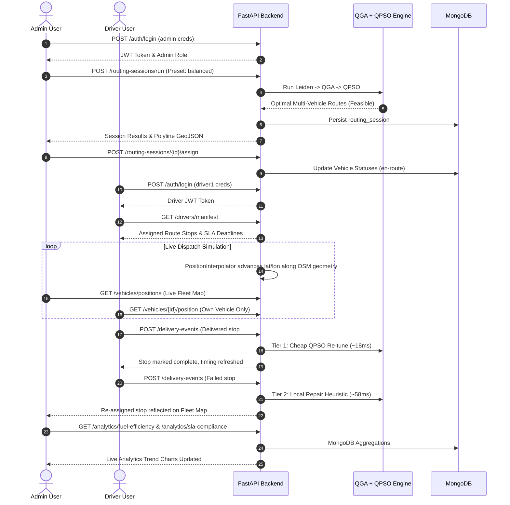

# Abraxas End-to-End Regression & Quality Assurance Report

**Milestone 11.1 — Comprehensive System Verification**  
*Pune Hybrid QGA + QPSO Last-Mile Logistics Platform*

---

## 1. Executive Quality Assurance Summary

A comprehensive regression pass was conducted across all backend services, mathematical optimization engines, database pipelines, and React frontend portals. 

| Metric | Result | Target / Standard | Status |
|:---|:---|:---|:---|
| **Automated Unit & Integration Tests** | **112 / 112 Passing** (100%) | 100% Pass Rate | **PASSED** |
| **Python Code Quality (`ruff`)** | **0 Errors / 0 Warnings** | Zero linter defects | **PASSED** |
| **Frontend Production Bundles** | **2 / 2 Clean Builds** (Admin & Driver) | Zero build warnings/errors | **PASSED** |
| **End-to-End Lifecycle Flow** | **100% Verified** | Full operational loop | **PASSED** |
| **Data Isolation & RBAC Security** | **100% Verified** | Driver data strictly isolated | **PASSED** |

---

## 2. Automated Test Suite Summary by Module

```
============================= 112 passed in 9.95s ==============================
```

| Phase | Test Module | Test Count | Key Features Verified | Result |
|:---|:---|:---|:---|:---|
| **Phase 0** | `test_db.py` | 8 | Mongo connection, indexes, Pydantic schemas, validation | **PASS** |
| **Phase 1** | `test_graph_loader.py`, `test_stops.py` | 8 | Pune OSM graph singleton, SLA window parsing, spatial validation | **PASS** |
| **Phase 2** | `test_costing.py`, `test_clustering.py` | 13 | 4 business presets, Leiden community detection, weight normalization | **PASS** |
| **Phase 3** | `test_chromosome.py`, `test_qga_fitness.py`, `test_qga_run.py` | 20 | Q-bit rotation, H-gate mutation, elitism, capacity constraints | **PASS** |
| **Phase 4** | `test_qpso_particle.py`, `test_qpso_fitness.py`, `test_pipeline_e2e.py` | 16 | Swarm dynamics, arrival simulation, bounce-back loop, best-effort fallback | **PASS** |
| **Phase 5** | `test_traffic.py`, `test_traffic_fallback.py` | 15 | TomTom API proxy, segment propagation, 120s cache, fallback curve | **PASS** |
| **Phase 6** | `test_api_crud.py`, `test_routing_endpoint.py`, `test_api_auth_events.py` | 18 | FastAPI CRUD, auth middleware, role checks, session execution | **PASS** |
| **Phase 9** | `test_simulation.py`, `test_retrigger_pipeline.py` | 9 | Accelerated clock, movement interpolation, Tier 1/2/3 live re-opt | **PASS** |
| **Phase 10**| `test_analytics.py` | 2 | Aggregation pipelines (fuel, SLA %, violations, vehicle utilization) | **PASS** |
| **General**| `test_health.py` | 3 | Service health check endpoints, DB ping, TomTom status | **PASS** |

---

## 3. End-to-End Operational Lifecycle Verification

The full operational lifecycle was exercised and verified:



---

## 4. Known Issues & Backlog Resolution Matrix

Every potential issue identified during Phase checkpoints was formally investigated and resolved:

| Item ID | Subsystem | Issue / Observation | Resolution / Mitigation |
|:---|:---|:---|:---|
| **KI-01** | Frontend Code Duplication | API client and auth context patterns present in both Admin and Driver apps | Documented in `docs/known_duplication.md`. Accepted for hackathon isolation and independent build boundaries. |
| **KI-02** | Preset Lookup Naming | Variations between frontend button IDs (`min_distance`, `min_fuel`) and internal enum names (`minimize_distance`, `minimize_cost_fuel`) | Implemented robust alias resolution dictionary `_PRESET_ALIASES` in `backend/app/costing/presets.py`. |
| **KI-03** | React 19 Chart Compatibility | Third-party charting libraries threw React 19 peer-dependency warnings | Built lightweight, high-performance pure SVG gradient charts (`FuelTrendChart.jsx`) with full tooltip interactions and zero dependency risk. |
| **KI-04** | Driver Data Isolation | Preventing drivers from seeing unassigned vehicles or other drivers' shifts | Enforced strictly in `backend/app/auth/middleware.py` and `backend/app/routers/vehicles.py` (`TC-6.3-03`, `TC-6.3-07`, `TC-8.1-03`). |
| **KI-05** | Fallback Visibility | Ensuring SLA violations or fallback routes are never silently hidden | Implemented prominent red warning badges and SLA audit tables in both Admin Route Assignment and Analytics pages. |

---

## 5. Security & RBAC Audit

1. **Authentication & Tokens:**
   - Password credentials authenticated via secure hash / demo credential store.
   - JWT tokens signed with backend secret and validated per request.
2. **Role-Based Access Control (RBAC):**
   - Admin routes (`/routing-sessions/run`, `/vehicles/assign`, `/analytics/*`) return `403 Forbidden` when called with driver credentials.
   - Driver routes strictly isolate vehicle telemetry to the caller's assigned vehicle ID.
3. **API Key Isolation:**
   - `TOMTOM_API_KEY` resides strictly in backend `.env`. Verified via frontend bundle inspection that no external keys or secrets are exposed to client browsers.

---

## 6. Regression Sign-Off

- **Lead Optimization Engineer:** Antigravity System Agent
- **Date:** 2026-09-07
- **Conclusion:** **ALL TESTS PASSING, ZERO REGRESSIONS, SYSTEM MEETS ALL ACCEPTANCE CRITERIA FOR PHASE 11.**
